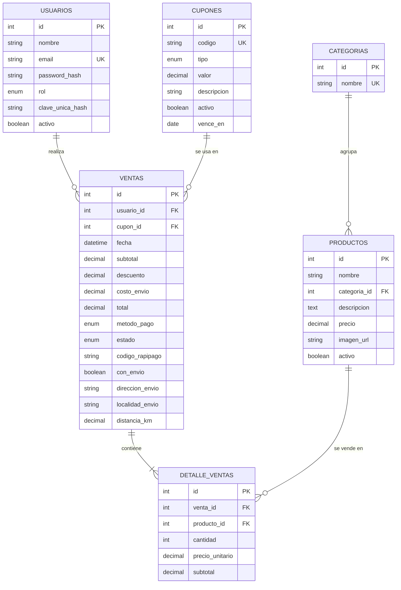

# Dulces Lucho App — Documentación del proyecto y del proceso

> Última actualización: 30 de octubre de 2026
> Repositorio: https://github.com/luchos-git/Dulces-Lucho-App
> Equipo: Luciano y Agustín

---

## El proyecto: Dulces Lucho

### Qué es el emprendimiento
**Dulces Lucho** es un emprendimiento que vende **bolsitas selladas con obleas Smacks de chocolate y un alfajor adentro**, en dos versiones:

| Versión | Contenido |
|---|---|
| Bolsita 3+1 | 3 obleas Smacks + 1 alfajor |
| Bolsita 4+1 | 4 obleas Smacks + 1 alfajor |

También se vendían **jugos Baggio**, solos (individuales) y junto a las bolsitas.

### A quién le vende y cómo
- Se vendía en la **escuela secundaria**, a **alumnos y profesores**, con **trato directo**.
- El producto es barato y abundante.

### Propuesta de valor frente al kiosco
- **Precios más bajos** que los del kiosco.
- **Comprar cómodo en el aula durante el recreo**, sin tener que ir al kiosco con una multitud de 25 personas.

### Cómo fideliza al cliente
- Con **precios bajos y estables** frente al kiosco (es lo que figura en "Relación con Clientes" del Modelo Canvas).

### Relación con los otros trabajos del proyecto
- **Modelo Canvas:** página web en HTML y CSS (repositorio `luchos-git/modelo-canva`), hecha por Luciano y Agustín.
- **Esta app:** prototipo para mostrar el catálogo del emprendimiento en el celular y armar un pedido.

### Qué es real y qué es una simulación en la app
- **Es real:** los productos, sus nombres y sus descripciones.
- **Es de ejemplo todavía:** los **precios** (hay que cargar los verdaderos en `data/productos.js`), las fotos y el local (coordenadas) que se usa para calcular el envío.
- **Es una simulación del prototipo:** el envío por distancia, los cupones, los medios de pago y las cuentas de cliente y administrador. Salen de la maqueta de Figma y **no describen cómo funciona hoy el emprendimiento**.

### Catálogo actual (`data/productos.js`)

| ID | Producto | Categoría | Precio |
|---|---|---|---|
| 1 | Bolsita Smacks 3 obleas + alfajor | Bolsitas | A cargar (hoy de ejemplo) |
| 2 | Bolsita Smacks 4 obleas + alfajor | Bolsitas | A cargar (hoy de ejemplo) |
| 3 | Jugo Baggio | Jugos | A cargar (hoy de ejemplo) |
| 4 | Combo 3 obleas + alfajor con jugo Baggio | Combos | A cargar (hoy de ejemplo) |
| 5 | Combo 4 obleas + alfajor con jugo Baggio | Combos | A cargar (hoy de ejemplo) |

Las categorías del inicio y los botones de filtro se arman solos a partir de este archivo: si se agrega un producto con una categoría nueva, aparece su sección sin tocar nada más.

### Qué falta definir
- Los **precios reales** de cada producto y las **fotos**.
- Qué productos incluyen las secciones de la maqueta de inicio: "Souvenirs Party!", "Plus Party!" y "Día Dulce!" (personalizado), y cómo funciona la oferta con temporizador.

---

## 1. La aplicación (prototipo)

**Dulces Lucho App** es un prototipo de aplicación móvil del emprendimiento descripto arriba: muestra el catálogo de bolsitas, jugos y combos y permite armar un pedido. Es un proyecto escolar hecho con **React Native y Expo**.

El cliente puede:

- Ver los productos por categoría y filtrarlos por categoría y precio.
- Entrar al detalle de un producto y elegir la cantidad.
- Armar un carrito, elegir si retira en el local o pide envío a domicilio, y ver el costo del envío según la distancia.
- Comprar directo desde el detalle ("Comprar ahora") o desde el carrito, con la misma pantalla de pago: ubicación de entrega, cupón y medio de pago (tarjeta de crédito, tarjeta de débito o Rapipago). No se puede confirmar sin elegir un medio de pago.
- Crear una cuenta e iniciar sesión como **cliente** (recibe una bienvenida y pasa al inicio) o como **administrador** (necesita, además de correo y contraseña, una clave única personal).

**Alcance actual:** es un prototipo de *frontend*. No hay base de datos ni servidor propio: los productos están escritos en el código y el carrito y las cuentas viven en la memoria de la app mientras está abierta. Los pagos son simulados. Este alcance se eligió siguiendo la indicación del profesor de avanzar primero con el frontend.

---

## 2. Tecnologías

| Parte | Qué usamos |
|---|---|
| Framework | React Native + Expo (SDK 57; React Native 0.86 y React 19.2) |
| Lenguaje | JavaScript |
| Navegación | React Navigation 7 (`@react-navigation/native` y `native-stack`) |
| Menú lateral | Componente propio hecho con la API `Animated` de React Native |
| Estado del carrito | Context API de React (`CarritoContext`) |
| Sesión y cuentas | Context API de React (`AuthContext`), solo en memoria |
| Ubicación y kilómetros | APIs gratuitas de OpenStreetMap: **Nominatim** (dirección → coordenadas) y **OSRM** (distancia por calles) |
| Probar en el celular | Expo Go |
| Control de versiones | Git y GitHub |
| Editor | Visual Studio Code |
| Asistencia | Consultas a asistentes de IA (Gemini y Claude) para entender errores y revisar código |

---

## 3. Cómo correr el proyecto

### Requisitos

- Node.js y Git instalados.
- Expo Go en el celular, en la versión que coincida con el SDK del proyecto (ver sección 10).
- Celular y compu en la **misma red WiFi**.

### Pasos

```
git clone https://github.com/luchos-git/Dulces-Lucho-App.git
cd Dulces-Lucho-App
npm install
npx expo start -c
```

Después se escanea el QR con Expo Go.

### Cosas a tener en cuenta en Windows

- **No poner el proyecto dentro de OneDrive** (Escritorio o Documentos suelen estar sincronizados). OneDrive puede corromper `node_modules` mientras `npm` instala. Conviene una carpeta como `C:\proyectos\Dulces-Lucho-App`.
- Si PowerShell dice que la ejecución de scripts está deshabilitada, abrir PowerShell **como administrador** y correr una sola vez:
  ```
  Set-ExecutionPolicy RemoteSigned -Scope CurrentUser
  ```
  Y usar la terminal de VS Code o una PowerShell normal.
- Si Expo Go pide iniciar sesión, correr `npx expo login` en la terminal y entrar con la misma cuenta en Expo Go.

---

## 4. Estructura de carpetas

```
Dulces-Lucho-App/
├── App.js                      ← Navegación: pantallas de cuenta o de la app según haya sesión
├── index.js                    ← Punto de entrada (registra App)
├── app.json                    ← Configuración de Expo
├── babel.config.js
├── package.json
├── components/
│   ├── EntregaEnvio.js         ← Retiro o envío: dirección, localidad y cálculo (se usa en carrito y pago)
│   └── ModalAgregar.js         ← Ventana para elegir la cantidad al agregar un recomendado
├── context/
│   ├── CarritoContext.js       ← Estado compartido del carrito
│   └── AuthContext.js          ← Cuentas, inicio de sesión y clave única del administrador
├── data/
│   ├── productos.js            ← Lista de productos (con descripción)
│   ├── cupones.js              ← Lista de cupones
│   └── usuarios.js             ← Cuentas de prueba y código de autorización de administrador
├── navigation/
│   └── DrawerMenu.js           ← Menú lateral propio (desliza desde la derecha)
├── screens/
│   ├── LoginScreen.js          ← Iniciar sesión
│   ├── RegistroScreen.js       ← Crear cuenta (cliente o administrador)
│   ├── ClaveAdminScreen.js     ← Clave única del administrador
│   ├── BienvenidaScreen.js     ← Bienvenida después de iniciar sesión
│   ├── HomeScreen.js           ← Inicio: ofertas, filtros y productos por categoría
│   ├── DetalleProducto.js      ← Detalle del producto, agregar al carrito o comprar ahora
│   ├── carrito.js              ← Carrito, entrega, cálculo de envío y recomendados
│   ├── prepararCompra.js       ← Entrega, cupón y medio de pago
│   └── PanelAdminScreen.js     ← Panel del administrador (en construcción)
├── services/
│   └── envio.js                ← Cálculo de distancia y costo de envío
└── database/
    ├── dulces_lucho.sql        ← Crea la base de datos (tablas y datos iniciales)
    ├── consultas_ejemplo.sql   ← Consultas listas para probar
    └── README.md               ← Cómo cargar la base
```

**Archivos heredados que no se usan** (se pueden borrar): la carpeta `src/` y `scripts/` que vienen de la plantilla de `create-expo-app`, y `screens/menu.js` (el diseño del menú ahora está en `navigation/DrawerMenu.js`).

---

## 5. Cómo funciona cada pantalla

### Cuentas (pantallas sin sesión)
- **Iniciar sesión (`LoginScreen.js`):** correo y contraseña. Si la cuenta es de **cliente**, entra directo. Si es de **administrador**, pasa a la pantalla de clave única.
- **Crear cuenta (`RegistroScreen.js`):** se elige el tipo (Cliente o Administrador) y se completan nombre, correo y contraseña (mínimo 6 caracteres, con confirmación). Para crear un administrador hay que ingresar además el **código de autorización de la tienda** y elegir una **clave única de 6 números**.
- **Clave única (`ClaveAdminScreen.js`):** solo para administradores, después de validar correo y contraseña. Tiene 3 intentos; si se falla 3 veces, vuelve al inicio de sesión.
- **Bienvenida (`BienvenidaScreen.js`):** después de entrar, saluda por el nombre ("¡Te damos la bienvenida, ...!") y un botón lleva a la pantalla de inicio. Si es administrador, muestra la etiqueta ADMINISTRADOR.
- **Cerrar sesión:** desde el menú ☰. Vacía el carrito y vuelve al inicio de sesión.

### Inicio (`HomeScreen.js`)
- Banner, "Ofertas del día" (los dos primeros productos) y los productos agrupados por categoría en una grilla de 2 columnas.
- **Filtros:** chips de categoría (se generan solos a partir de la lista de productos) y rango de precio mínimo/máximo. Un solo `.filter()` aplica las dos condiciones.
- Si el precio mínimo es mayor que el máximo, los campos se marcan en rojo y aparece un mensaje de error.
- Tocar un producto abre su detalle.

### Detalle (`DetalleProducto.js`)
- Muestra nombre, categoría, precio y descripción, con selector de cantidad (− / +).
- "Agregar al carrito" guarda el producto en el `CarritoContext`.
- **"Comprar ahora"** abre directamente la pantalla **Preparar compra** con ese solo producto y la cantidad elegida (compra directa: no usa ni modifica el carrito).

### Carrito (`carrito.js`)
- Casilla "Seleccionar todo", casilla por producto, botones − / + para la cantidad y tacho para borrar.
- Tocar la fila de un producto abre su detalle; la flecha de volver regresa al carrito.
- **Entrega:** retiro en el local o envío a domicilio. Con envío se escriben la calle y número y la **localidad**, y se toca "Calcular envío". El resultado muestra **desde dónde y hasta dónde** se midió, los kilómetros y el costo.
- **Recomendados:** 2 productos **al azar** que todavía no están en el carrito (se sortean de nuevo cada vez que se entra al carrito). "Agregar" abre una ventana con la foto, la descripción, el precio y un selector de cantidad; al confirmar, el producto se suma al carrito.
- El total suma solo los productos tildados, más el envío.
- "Preparar compra" abre la pantalla de pago.

### Preparar compra (`prepararCompra.js`)
- Resumen del pedido y la **entrega**, que se puede elegir o cambiar en la misma pantalla (retiro en el local o envío a domicilio, con el mismo cálculo y la misma información de desde/hasta). Si se llegó desde el carrito, la entrega ya viene cargada.
- **Cupón de descuento** (ver sección 6).
- **Medio de pago:** crédito, débito (con validación de número, titular, vencimiento y código) o Rapipago (genera un código de pago de ejemplo).
- **El botón "Confirmar compra" queda inactivo hasta elegir un medio de pago**, y al tocarlo se vuelve a validar todo (medio de pago, envío calculado si corresponde y datos de la tarjeta).
- Al confirmar se vuelve al inicio. Si la compra vino del carrito, los productos comprados salen del carrito; si fue "Comprar ahora", el carrito queda como estaba.

### Menú lateral (`DrawerMenu.js`)
- Se abre con el botón ☰ del encabezado y desliza desde la derecha. Muestra el nombre de quien inició sesión y tiene "Inicio", "Carrito", "Panel de administración" (solo para administradores) y "Cerrar sesión". Tocar afuera lo cierra.

### Panel de administración (`PanelAdminScreen.js`)
- Solo accesible para administradores. Por ahora es una pantalla en construcción: las funciones previstas (agregar productos con ID automático, pedidos, cupones) necesitan guardar datos, y el backend está pausado.

---

## 6. Reglas de negocio

### Envío
- **Gratis hasta 1,5 km** desde el local.
- Pasado 1,5 km: **$300 por cada km extra**, redondeando hacia arriba (por ejemplo, a 2,3 km se cobra 1 km extra = $300).
- Los valores están en `services/envio.js` (`UMBRAL_GRATIS_KM`, `COSTO_POR_KM_EXTRA`) y se cambian ahí.
- Las coordenadas del local (`LOCAL`) en ese archivo son de ejemplo: hay que reemplazarlas por las reales.

**Cómo se calcula (de qué punto a qué punto):**
1. **Destino:** Nominatim busca el texto "calle y número, localidad, Buenos Aires, Argentina" y devuelve la **primera coincidencia** con sus coordenadas. La app muestra la dirección completa que encontró (campo "Hasta") para que el cliente pueda comprobar que es la suya. Por eso se pide la localidad: muchos nombres de calle (por ejemplo "Av. Mitre") existen en varias localidades.
2. **Origen:** son las coordenadas del local, definidas en `services/envio.js` (`LOCAL` y `LOCAL_NOMBRE`). Hoy son un punto de ejemplo en el centro de la ciudad de Buenos Aires: **hay que reemplazarlas por las del local real**. Mientras tanto, los kilómetros se miden desde ese punto de ejemplo.
3. **Distancia:** OSRM calcula el recorrido real por las calles entre el origen y el destino.
4. Si OSRM no responde, se usa la distancia en línea recta (fórmula de Haversine) como plan B, y la pantalla lo avisa ("en línea recta, aproximado").

**Limitaciones:** son servicios públicos y gratuitos, sin garantía de disponibilidad. Nominatim pide máximo una consulta por segundo y que la app se identifique (por eso el `User-Agent`). OSRM calcula rutas en auto. Los datos son de OpenStreetMap.

### Cupones (`data/cupones.js`)

| Código | Efecto |
|---|---|
| `DULCE10` | 10% de descuento sobre el subtotal |
| `LUCHO500` | $500 de descuento |
| `ENVIOGRATIS` | Envío gratis (solo con envío a domicilio) |

Para agregar uno, se suma una línea más a la lista. El cupón del juego de la maqueta de Figma se podría sumar de la misma forma.

### Cuentas y roles (`context/AuthContext.js`, `data/usuarios.js`)

| Tipo | Cómo entra | Qué ve |
|---|---|---|
| **Cliente** | Correo y contraseña | Bienvenida con su nombre y la pantalla de inicio |
| **Administrador** | Correo y contraseña, y después su **clave única** de 6 números | Bienvenida de administrador, la pantalla de inicio y el "Panel de administración" en el menú |

- **Crear una cuenta de administrador** exige el *código de autorización de la tienda* (`CODIGO_AUTORIZACION_ADMIN` en `data/usuarios.js`), para que cualquiera no pueda registrarse como administrador. Cada administrador elige su propia clave única.
- **Cuentas de prueba:**
  - Cliente: `cliente@dulceslucho.com` / `cliente123`
  - Administrador: `admin@dulceslucho.com` / `admin123`, clave única `482913`
  - Código de autorización para crear administradores: `DULCES-ADMIN-2026` (cambiarlo por uno propio)
- **Limitación importante:** es una simulación de frontend. Las cuentas nuevas viven **solo mientras la app está abierta** y las contraseñas y claves están en el código. Una app real necesita un servidor que guarde las contraseñas cifradas y valide el código y la clave única. La base de datos que lo va a guardar ya está diseñada (sección 13), pero **la app todavía no se conecta a ella**.

### Pagos
Son **simulados**: las tarjetas se validan pero nada se guarda ni se envía. **No se puede confirmar la compra sin elegir un medio de pago.** Para cobrar de verdad no se arma un formulario propio: se usa un servicio de pagos (por ejemplo, Mercado Pago), que se encarga de los datos de la tarjeta.

---

## 7. Historial del proceso: problemas y cómo se resolvieron

Este proyecto tuvo cerca de un mes de errores de instalación y configuración antes de funcionar de forma estable. Se deja registrado para no repetirlos.

| # | Problema | Causa | Solución |
|---|---|---|---|
| 1 | Pantalla roja `Cannot find module 'babel-preset-expo'` | Instalación incompleta o corrupta de `node_modules` (la carpeta estaba en OneDrive) y caché vieja de Metro | Mover el proyecto fuera de OneDrive, reinstalar de cero y arrancar con `npx expo start -c` |
| 2 | `npm install` fallaba con `ERESOLVE` | El `package.json` mezclaba Expo SDK 54 con React 18.2, React Native 0.73 y librerías de otras épocas (por ejemplo `react-native-screens` 4.25, que pide React Native 0.82 o más) | Armar un `package.json` limpio con las versiones del SDK e instalar las librerías con `npx expo install` |
| 3 | `main` apuntaba a un `index.js` inexistente | Solo existía `App.js` | Crear `index.js` con `registerRootComponent(App)` |
| 4 | `Unable to resolve "../screens/menu"` | Rutas de importación mal escritas (`./` y `../`) | `./` = misma carpeta, `../` = una carpeta arriba. Corregir cada ruta |
| 5 | Import apagado en gris y `MenuScreen is not defined` | Se usaba un componente que nunca se importó ni existía | Usar el componente correcto o quitar el import sin uso |
| 6 | Dos aplicaciones mezcladas | Un `App.js` viejo y un `AppNavigator.js` nuevo, más la plantilla de Expo Router (`src/app`) sin usar | Un solo punto de entrada: `index.js` → `App.js` → navegación |
| 7 | Dos ramas desincronizadas en GitHub (`main` y `principal`) | `main` quedó con la versión vieja y rota, y GitHub la usa por defecto | Crear un repositorio nuevo con historial limpio |
| 8 | Crash en el celular: `TurboModule method "installTurboModule" called with 1 arguments (expected argument count: 0)` | El menú de `@react-navigation/drawer` depende de `react-native-reanimated` 4 y `react-native-worklets`; en Expo Go hubo un conflicto de módulo nativo que no se resolvió reinstalando, limpiando la caché ni quitando el plugin duplicado de `babel.config.js` | Sacar drawer, reanimated, worklets y gesture-handler. Menú lateral propio con `Animated` y navegación con `native-stack` |
| 9 | PowerShell: "la ejecución de scripts está deshabilitada" | Política de ejecución de Windows | `Set-ExecutionPolicy RemoteSigned -Scope CurrentUser` (como administrador) |
| 10 | Pantalla azul `Failed to download remote update` | El celular no se conecta con la compu | Servidor corriendo (`npx expo start -c`), misma red WiFi (misma banda), Node.js permitido en el Firewall; si falla, cable USB con depuración USB o hotspot del celular |
| 11 | `@react-native-async-storage/async-storage` "added as a dependency but not installed" | Después de `git pull`, faltaba instalar lo que el otro agregó | Correr `npm install` después de cada `git pull` |
| 12 | Expo Go se actualizó y dejó de abrir el proyecto (SDK 54) | Expo Go solo soporta un SDK a la vez | Actualizar a SDK 57 (sección 10) |
| 13 | `expo-doctor` marcaba `splash` en `app.json`, `babel-preset-expo`, `typescript` y `@types/react` | En SDK 57 `splash` ya no va en `app.json` y esos paquetes quedaron en la versión vieja | Borrar el bloque `splash`, correr `npx expo install --check` y dejar `babel-preset-expo ~57.0.0`, `typescript ~6.0.3` y `@types/react ~19.2.4` |
| 14 | `Render Error: Got an invalid value for 'component' prop for the screen 'Carrito'` | React Navigation recibió `undefined` en lugar de un componente. Causas típicas: el archivo de la pantalla no tiene `export default function ...` (por ejemplo, quedó incompleto después de pegar un cambio), o el `import` de `App.js` no coincide con la ruta o el nombre real del archivo | Revisar que `screens/carrito.js` tenga una sola línea `export default function CarritoScreen(...)` y que `App.js` lo importe como `import CarritoScreen from './screens/carrito'`. Si hay dudas, reemplazar el archivo completo. **Regla:** cada pantalla debe exportar su componente con `export default` |
| 15 | Los kilómetros de envío no decían de qué punto a qué punto (por ejemplo, "Av. Mitre 200" daba unos 13 km) | El origen era un punto de ejemplo del local, y Nominatim toma la primera coincidencia de un nombre de calle que existe en muchas localidades | La pantalla muestra "Desde" y "Hasta" (con la dirección completa encontrada), se pide la localidad, y hay que cargar las coordenadas reales del local en `services/envio.js` |
| 16 | Se podía tocar "Confirmar compra" sin haber elegido un medio de pago | El botón de confirmar estaba siempre habilitado | El botón queda inactivo ("Elegí un medio de pago") hasta elegir uno, y al tocarlo se vuelve a validar todo |

### Lecciones aprendidas

1. Para instalar librerías de Expo o React Native usar **`npx expo install nombre`**, nunca `npm install nombre` a secas.
2. No usar `npm audit fix --force` ni `--legacy-peer-deps`: rompen las versiones que Expo necesita.
3. Si algo "no se arregla" después de reinstalar, probar `npx expo start -c` (limpia la caché).
4. Leer el mensaje de error completo: casi siempre nombra el archivo y la línea del problema.
5. Hacer commit de un estado que funciona **antes** de cambiar cosas grandes.
6. Cuando falla en el celular pero anda en la web, el problema suele ser un módulo nativo.

---

## 8. Decisiones técnicas

- **Menú lateral propio en vez de `createDrawerNavigator`:** el drawer oficial dependía de librerías nativas que fallaban en Expo Go (problema 8). La versión propia con `Animated` no usa módulos nativos extra y conserva React Navigation para la navegación entre pantallas.
- **Carrito sin persistencia:** vive en el `CarritoContext` y se pierde al cerrar la app. El guardado se pausó a pedido del profesor (primero el frontend).
- **Backend pausado:** se había armado una versión con productos guardados en el celular (`AsyncStorage`), un `ProductosContext` y una pantalla de Admin para agregar productos, con ID autoincremental (el máximo ID existente + 1). Se dejó de lado por ahora. Si se retoma, esa es la idea a seguir. Los archivos `context/ProductosContext.js` y `screens/AdminScreens.js` siguen en el repositorio sin usarse, y `ProductosContext.js` todavía trae el catálogo de ejemplo viejo: habría que cargarlo desde `data/productos.js`.
- **APIs gratuitas en vez de Google Maps:** Google Maps Platform requiere una cuenta de facturación con tarjeta. Para un prototipo se eligieron Nominatim y OSRM, que no necesitan clave ni cuenta.
- **Pagos simulados:** no se procesa ni se guarda ningún dato de tarjeta.
- **Cuentas en memoria:** el inicio de sesión se simula con un `AuthContext` y no guarda nada, igual que el carrito. La autenticación real queda para cuando se retome el backend. El ingreso de un administrador tiene dos pasos (contraseña y clave única) y crear un administrador exige un código de autorización.
- **Una sola pantalla de pago:** tanto "Comprar ahora" como "Preparar compra" del carrito abren `PrepararCompra`. La parte de entrega (retiro o envío) es un componente compartido (`components/EntregaEnvio.js`), así se puede elegir en cualquiera de las dos pantallas.
- **Recomendados al azar:** se mezcla la lista de productos (algoritmo de Fisher-Yates) y se toman los dos primeros que no estén en el carrito. Se vuelve a mezclar cada vez que se entra al carrito.

---

## 9. Trabajo en equipo con Git

1. **Antes de empezar a programar:** `git pull`, y después `npm install` (puede haber dependencias nuevas).
2. **Commits chicos y seguidos:** cada vez que algo funcione, `git add .`, `git commit -m "qué se hizo"` y `git push`.
3. **Avisarse** antes de tocar un archivo grande (por ejemplo `HomeScreen.js`) para no pisarse.
4. **Si hay un conflicto** (`CONFLICT` en el `git pull`): abrir el archivo, decidir entre los dos qué versión queda, borrar las marcas `<<<<<<<`, `=======` y `>>>>>>>`, y hacer commit.
5. El `package-lock.json` **se sube al repositorio**, así los dos instalan las mismas versiones.
6. Archivos que no se suben: `node_modules/` y `.expo/` (ya están en `.gitignore`).

---

## 10. Versiones y cómo actualizar el SDK

**Expo Go solo soporta un SDK a la vez.** Cuando la tienda actualiza Expo Go a un SDK nuevo, los proyectos de un SDK anterior dejan de abrirse hasta actualizarlos.

- El proyecto está hoy en **SDK 57**.
- El **SDK 58** salió el 15 de octubre de 2026. Expo Go de las tiendas pasará a SDK 58 en unas semanas.

### Pasos para actualizar (reemplazar 57 por el número nuevo)

```
git add .
git commit -m "Antes de actualizar el SDK"
git push

npx expo install expo@^57.0.0
npx expo install --fix
npx expo-doctor
npx expo start -c
```

Si `npm` da `ERESOLVE`:

```
rd /s /q node_modules
del package-lock.json
npm install
```

Después se sube el cambio y la otra persona hace `git pull` y `npm install`, con Expo Go actualizado en su celular.

### Probar con una versión puntual de Expo Go
En Android se puede instalar la versión de Expo Go que coincida con el SDK desde **expo.dev/go** (hay que desinstalar la actual y desactivar la actualización automática en Play Store).

---

## 11. Comandos útiles

| Para qué | Comando |
|---|---|
| Instalar dependencias | `npm install` |
| Arrancar el proyecto | `npx expo start` |
| Arrancar limpiando la caché | `npx expo start -c` |
| Cortar el servidor | `Ctrl + C` |
| Recargar la app | Tecla `r` en la terminal |
| Instalar una librería | `npx expo install nombre-paquete` |
| Revisar versiones | `npx expo install --check` |
| Diagnóstico del proyecto | `npx expo-doctor` |
| Traer cambios | `git pull` |
| Subir cambios | `git add .` y `git commit -m "mensaje"` y `git push` |

---

## 12. Pendientes y próximos pasos

- Reemplazar las coordenadas de ejemplo del local en `services/envio.js` por las reales.
- Cargar los **precios reales** en `data/productos.js` (los productos ya son los del emprendimiento; los precios son de ejemplo) y las fotos de cada producto.
- Definir y armar las secciones de la maqueta de inicio que faltan: "Souvenirs Party!", "Plus Party!", "Día Dulce!" (personalizado) y la oferta con temporizador.
- Armar el banner de promo y la sección del cupón por jugar un juego (según la maqueta de Figma).
- Agregar cuotas para la tarjeta de crédito.
- Retomar el backend cuando el profesor lo indique: guardar productos y cuentas (con contraseñas cifradas y validación de la clave única en el servidor), panel de administración con ID autoincremental y pagos reales con un servicio como Mercado Pago.
- Completar el panel de administración (hoy es una pantalla en construcción).
- Armar la API (por ejemplo con Express y `mysql2`) que conecte la app con la base de datos `dulces_lucho` (sección 13): iniciar sesión, listar productos y registrar ventas.
- Cambiar el código de autorización de administrador y las cuentas de prueba antes de entregar o publicar el proyecto.
- Actualizar al SDK 58 cuando Expo Go lo pida.
- Borrar los archivos heredados de la plantilla (`src/`, `scripts/`, `screens/menu.js`).

---

## 13. Base de datos (usuarios, productos y ventas)

La base se llama **`dulces_lucho`** y está pensada para **MySQL 8 / MariaDB 10.4 o más nuevo** (sirve XAMPP, MySQL Workbench, etc.). Está en la carpeta `database/`:

| Archivo | Para qué sirve |
|---|---|
| `dulces_lucho.sql` | Crea la base con todas las tablas y los datos iniciales |
| `consultas_ejemplo.sql` | Consultas para probar: catálogo, ventas, más vendidos, ventas por mes, etc. |
| `README.md` | Pasos para cargarla con phpMyAdmin, Workbench o la terminal |

### Cómo se relacionan las tablas



### Qué guarda cada tabla

| Tabla | Qué guarda |
|---|---|
| `categorias` | Bolsitas, Jugos y Combos. Una categoría por fila, para no repetir el texto en cada producto. |
| `productos` | El catálogo. El `id` se **autoincrementa solo**. `activo = 0` oculta un producto sin borrarlo. |
| `cupones` | Código, tipo (`porcentaje`, `monto` o `envioGratis`), valor y si está activo. |
| `usuarios` | Clientes y administradores. Guarda la contraseña y la clave única **cifradas** (hash bcrypt), nunca en texto. |
| `ventas` | Una fila por compra: cliente, cupón usado, subtotal, descuento, envío, total, medio de pago, estado y datos de entrega. |
| `detalle_ventas` | Los productos de cada compra, con la cantidad y el **precio que tenían en ese momento**. |

### Reglas que la propia base hace cumplir
- Un **administrador siempre tiene clave única** y un cliente nunca.
- El **email** de cada usuario es único.
- El **total** de una venta tiene que ser `subtotal - descuento + costo de envío`.
- Si la venta es **con envío**, tienen que estar la dirección, la localidad y los kilómetros.
- La cantidad de un producto en una venta es mayor que 0, y un producto aparece una sola vez por venta.
- Los precios no pueden ser negativos.
- **No se puede borrar un producto que ya se vendió**; se lo oculta con `activo = 0`.
- Si se borra una venta, su detalle se borra con ella.
- **No se guardan datos de tarjeta**: solo el medio de pago elegido (con tarjeta la venta queda `pagada`; con Rapipago queda `pendiente` hasta que se abone).

### Cómo se corresponde con la app

| En la app | En la base |
|---|---|
| `data/productos.js` (`nombre`, `categoria`, `precio`, `descripcion`) | `productos` (`nombre`, `categoria_id` → `categorias`, `precio`, `descripcion`) |
| `data/cupones.js` (`codigo`, `tipo`, `valor`, `descripcion`) | `cupones` (mismas columnas) |
| `data/usuarios.js` y `AuthContext` (`nombre`, `email`, `password`, `rol`, `claveUnica`) | `usuarios` (`nombre`, `email`, `password_hash`, `rol`, `clave_unica_hash`) |
| Compra confirmada en `prepararCompra.js` | Una fila en `ventas` y una en `detalle_ventas` por cada producto |

Los precios en la base son `DECIMAL`, y las librerías los devuelven como texto: hay que convertirlos con `Number(...)` antes de mostrarlos o sumarlos en la app.

### Cómo cargarla
1. Encender MySQL (por ejemplo, desde el panel de XAMPP).
2. Importar `database/dulces_lucho.sql` (phpMyAdmin → pestaña **Importar**, o MySQL Workbench, o `mysql -u root -p < dulces_lucho.sql`).
3. Probar las consultas de `consultas_ejemplo.sql`.

⚠️ El script **borra y vuelve a crear** las tablas: si ya hay datos reales, hay que hacer una copia antes de volver a ejecutarlo.

**Cuentas de prueba (las mismas de la app):** `cliente@dulceslucho.com` / `cliente123` y `admin@dulceslucho.com` / `admin123` (clave única `482913`). Los **precios** de los productos son de ejemplo.

### Qué falta para conectarla con la app
La app todavía **no se conecta** a la base: el catálogo, las cuentas y las ventas siguen viviendo en la memoria del celular. Falta armar un servidor (API) que lea y escriba en esta base, con rutas para iniciar sesión, listar productos, validar cupones y registrar ventas. Las contraseñas se tienen que cifrar con bcrypt en ese servidor, nunca en la app.
